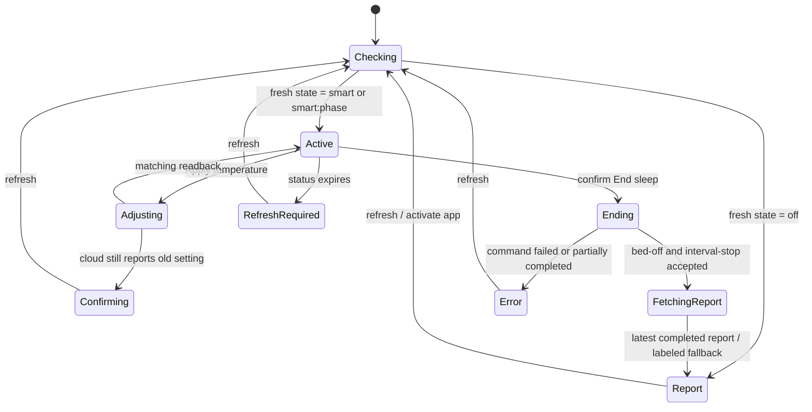

# Home screen state machine

Updated October 17, 2026. Controls are embedded on the home screen. There is no
separate Pod controls destination and no Turn on action in the native app.
Power state is not treated as proof that a sleep interval exists.

| State | Home screen | Available actions |
| --- | --- | --- |
| Checking | Progress | None |
| Active (`smart` or `smart:phase`) | Current temperature, adjustment slider, Apply temperature, End sleep | Apply temperature, confirmed End sleep, refresh |
| Adjusting / confirming | Progress or Awaiting confirmation | Refresh after request finishes |
| Ending / fetching report | Progress until stop and report fetch finish | None |
| Off | Latest completed report, or No report yet | Refresh, Settings |
| Stale active status | Refresh required | Refresh, Settings |
| Failed/unknown status | Explicit status/error and latest available report | Refresh, Settings |

The report is hidden while active controls are displayed. End sleep still sends
power-off first, then stops the newest recent incomplete interval. Only successful
completion triggers a forced report request. Partial failures remain errors rather
than announcing a finished sleep session. Once both writes are accepted, the home
screen proceeds to the report even if temperature readback has not caught up;
a later refresh reads the actual current power state again.

Eight Sleep may still be processing the newest report. The app shows the latest
completed report returned by the provider with its date, or its labeled cached
fallback on failure. No new result is fabricated and there is no background poll.

On Watch, Refresh is a button. On iPhone, refresh is a pull-down gesture. Both
reread power first and fetch a report when applicable. Opening/activation and
returning from Settings do the same. Active controls require status younger than
60 seconds. Unknown states never enable temperature writes. The core action
policy rejects Turn on even if a stale native UI were to attempt it. The legacy
API operation remains only for compatibility with the separate web diagnostics;
it is not a native app action.

## Live mode diagnosis — October 17

Read-only requests to app `/temperature`, client `/temperature`, and app
`/temperature/all` all returned the active mode `smart:bedtime`. Previously only
exact `smart` matched On, so active phase-qualified modes were incorrectly
classified unsupported and routed to the report. The shared status predicate now
recognizes `smart` and nonempty `smart:` phase suffixes, including command readback
and clearing the completed-sleep screen override after the bed turns on again.
Unrecognized mode families remain unavailable and are explicitly labeled on the
report fallback. The native demo-on fixture uses the observed bedtime mode.
No bed-control writes were made to diagnose this issue.
